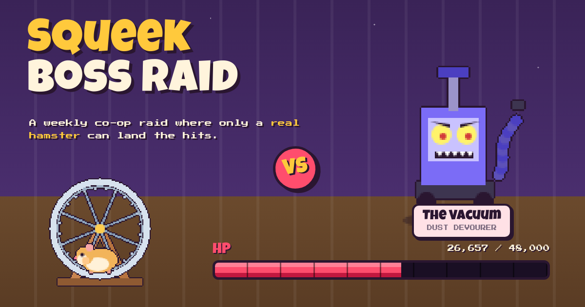

# Squeek Boss Raid

squeekchain-verify: PASTE REPOSITORY VERIFICATION LINE HERE



**A weekly co-op boss raid where only a real hamster can land the hits.**

Every Monday at 00:00 UTC a new boss moves into the cage: The Cat, The Vacuum, The Vet, The Bath, The Empty Bowl or The Owl. Its HP drops only when **Squeektoshi** runs on the **WHEELY9000**: each wheel pass SqueekCore certifies on Sepolia is one point of damage. Players enlist with a class, call the next ten-minute rounds (Nap, Jab or Smash) and climb a leaderboard that anyone can recompute from the chain. If the boss is still standing next Monday, it escapes.

It's a single static page with no backend, no build step and no API keys, and it runs on GitHub Pages as is.

---

## How to play

1. **Watch.** The arena shows Squeektoshi on his wheel (spinning at his live RPM when the API is reachable) facing this week's boss. Each certified round with work fires a seed volley and knocks HP off the bar. Work the wheel has counted but SqueekCore hasn't settled yet shows as a striped "unsettled" segment.
2. **Pick a class** (it's locked for the week once you enlist):
   | Class | Perk |
   |---|---|
   | Wheel Warrior | Assists on Smash rounds count ×1.5; correct Smash calls ×1.5 |
   | Seed Mage | Correct Jab calls ×1.5; crit streak grows +20% per step instead of +10% |
   | Cheek Pouch Tank | All assists ×1.25; a wrong call never breaks the streak |
   | Nap Healer | Correct Nap calls ×3; **Second Wind** +50 when he wakes after 6+ nap rounds |
3. **Call the next 16 rounds** (2 h 40 min). Tap each round to cycle `–` → Nap → Jab → Smash.
4. **Sign a Raid Order** from your wallet on Sepolia. It's one `approve()` that writes your class and calls on-chain (details below). You can send a new order at any time to re-plan; a later order replaces your calls for rounds that haven't started.
5. **Score**, all computed in your browser from chain data:
   - **Assists:** 1 point per 10 wheel passes in every round after you enlisted (with class modifiers).
   - **Calls:** a round is **Nap** (0 work), **Jab** (1–399) or **Smash** (400+). Correct calls score 10 / 100 / 120, and each correct call in a row adds +10% (capped at +100%).
   - **Victory:** if cumulative damage reaches the boss's HP, everyone enlisted before the killing round gets **+500 Raid Clear**, and a correct call on the killing round earns **+250 Last Hit**. Scoring stops when the boss falls.
   - Otherwise the week ends with **"The boss escaped"**.

Use ◀ ▶ in the arena to replay past weeks. They're recomputed from the chain the same way.

Bosses rotate by week number (`(week-1) % 6`) with fixed HP: The Cat 42,000 · The Vacuum 48,000 · The Vet 36,000 · The Bath 44,000 · The Empty Bowl 40,000 · The Owl 52,000 wheel passes. These targets come from Squeektoshi's observed pace on Sepolia: about 21k certified passes from Monday 2 Nov to Wednesday night, with active rounds averaging ~400 passes. A boss is beatable but only if he has a good week.

---

## How it uses Squeekchain

### 1. SqueekCore on Sepolia (source of truth for damage and round results)

Read through public JSON-RPC (`ethereum-sepolia-rpc.publicnode.com`, then `sepolia.drpc.org`, `1rpc.io/sepolia`, `rpc.sepolia.org`):

| Call | Used for |
|---|---|
| `configuration()` → `genesisTimestamp`, `roundDuration` | map SqueekCore round *r* to wall-clock time: round *r* covers `[genesis + (r-1)·600, genesis + r·600)` (docs: "V3 has no currentRound()") |
| `state()` → `settledThroughRound`, `cumulativeWork`, `blockHeight`, `paused` | certified frontier; rounds after it are shown as "settling", never as zero |
| `roundPage(afterRound, throughRound, maxRecords≤16)` → `start/end.cumulativeWork`, `rounds[].roundId`, `rounds[].cumulativeWork` | per-round work for the week: `work = cumulativeWork − previous cumulativeWork`. Rounds omitted from a page are certified **zero work** (naps) |

Selectors are computed at runtime with `ethers.id()` from the signatures in the [SqueekCore reference](https://docs.squeekchain.com/developers/core/).

**Deployments.** Squeekchain's Sepolia deployment has been re-deployed more than once, so the game doesn't trust a single address. It reads every known SqueekCore and merges their certified rounds **by wall-clock 10-minute slot, taking the max** (rounds are 600 s and every genesis is slot-aligned). The same run can never be counted twice. Raid Orders go to the SQK token of the core with the most recent certified frontier. All addresses were checked on Sepolia on 2026-11-05 (`SQK.mining()` → SqueekMining, `SqueekMining.core()` → SqueekCore, `symbol()` = SQK):

| Release | SqueekCore | SQK token | SqueekMining | genesis | Source |
|---|---|---|---|---|---|
| `core-sepolia-20261103` | `0xFD6C166D4B8E2962E65746a13e5a0797CD4dE0c4` | `0xd78a3956cF63164d1Fa1C622ad3c66623162Fa1e` | `0x2dCcB11fcC2dEfdd188555e45aCb52231e82e218` | 1793735400 | `GET /v1/core`, `/v1/economy/state` (`deployment.components`) |
| stream-game (Sepolia) | `0x980B4424c007CAf7a1f3670B48c8EaEf7EbC3d44` | `0x5501E1Fa81Be1c3F49225fa7668DA0245d07Db60` | `0xcd46990f8349057335289Ef282c276204B6CDC62` | 1793022600 | on-chain links; also used by squeek.mfbrat.com |
| docs launch | `0x74665dAecA35A2303e767E76a2FF1FB6F93e119f` | `0x6872BfA5CcC3E9e440C6c16e5fFdAbb8DBA4Cc76` | `0x3beE588fC20dE788Bac17d33b41Da7346cb27EC4` | 1791847800 | [docs Deployments / sepolia-env.sh](https://docs.squeekchain.com/developers/) |

The Proof & data card on the page shows, live, which core is settling, its frontier, and how many certified rounds each one contributed to the week.

### 2. Squeekchain public API (live display only, never scored)

`https://api.squeekchain.com/v1` ([reference](https://docs.squeekchain.com/developers/api/)), polled every 15 s:

- `GET /v1/status`: `schemaVersion`, `measurement.freshness` (online/stale), `measurement.coreStatus` (IDLE/ACTIVE/COUNTER_FAULT), `measurement.rpmMilli`, `measurement.speedMmPerSecond`, `measurement.distanceMm`, `measurement.cumulativeWorkUnits` + `measurement.counterEpoch` (live "swings" between polls), `builder.status`, `builder.queued.openRoundWorkUnits` and `builder.queued.closedWorkUnits` (the striped unsettled HP segment).
- `GET /v1/core`: `installationId`, `identities.core`, `configuration.genesisTimestamp`, `core.settledThroughRound`, `core.paused` (shown in Proof & data).

The wheel animation, RPM, speed and today's distance come from the API. **Damage and points come only from SqueekCore**, so an API hiccup can't change a score.

### 3. Raid Orders: on-chain, no backend

Joining and calling rounds is one Sepolia transaction from the player's wallet:

```
SQK.approve(spender = RAID_SIGIL, value)
RAID_SIGIL = 0x4EC63CB72aD4701A640370A59c73c16431D3e330
           = last 20 bytes of keccak256("squeek-boss-raid:sigil:v1")   // no private key exists
value (decimal, always < 1 SQK = 10^18 base units):
  8 C SSSSSS PPPPPPPPPP
  │ │ │      └ 16 round calls in base 4 (0 none · 1 Nap · 2 Jab · 3 Smash), call i is for slot S+i
  │ │ └ first planned slot: 10-minute slots since the season epoch (Mon 2026-10-26 00:00 UTC)
  │ └ class 1 Warrior · 2 Mage · 3 Tank · 4 Healer
  └ magic digit
```

The roster and leaderboard are rebuilt from `Approval(owner, spender = RAID_SIGIL, value)` logs on the known SQK tokens. They come from [Blockscout's](https://eth-sepolia.blockscout.com/api) keyless Etherscan-style `getLogs` (filtered by `topic2 = sigil`), topped up with `eth_getLogs` on the public RPC for the newest blocks (publicnode only keeps ~12k blocks of logs). Rules applied to every order:

- An order belongs to the week of its first planned slot and must be mined before that week ends. Your class is the class of your first order that week.
- A call counts only if the round **started at or after the block timestamp** of the transaction that made it. You can't call a round that's already running.
- For each round, your most recent valid call wins.

---

## Fairness and safety

- **Testnet only.** Chain 11155111 (Sepolia). Test SQK has no monetary value. The game never asks for private keys or seed phrases and never holds funds.
- **The approval can't move anything.** The value is below 1 test SQK, and the spender is a hash-derived address nobody holds a key for. You pay only Sepolia test gas. Your wallet will show it as a spending-cap approval to that address; you can reset it any time with `approve(sigil, 0)` (which the game simply ignores).
- **Deterministic.** `js/game.js` is a pure function of (certified rounds, Approval logs). No server, no randomness, no wall clock in scoring (only block timestamps and round boundaries). Anyone can recompute the board. `tests/rules.test.js` checks the rules.
- **Real damage only.** Players can't affect damage. The hamster's wheel time is never forced or encouraged by the game, and naps score too (Nap calls, Nap Healer).
- **Honest states.** Rounds past SqueekCore's frontier show as "settling", never as naps. If the API is unreachable, the live panel says so and the arena falls back to SqueekCore's latest certified rounds. If the logs source is limited, the Orders pill turns amber. If neither the API nor any RPC answers, the page switches to a **demo** with a striped DEMO ribbon and simulated data (also available with `?demo=1`). Demo data is never mixed with real data.
- Wallet states are handled: no wallet (install hint, watching still works), wrong network (one-click `wallet_switchEthereumChain` / `wallet_addEthereumChain` for Sepolia), rejected transaction, insufficient gas.

---

## Run locally

```bash
git clone <this repo> && cd squeek-boss-raid
python3 -m http.server 8000
# open http://localhost:8000          (live)
# open http://localhost:8000/?demo=1  (labeled demo data)
node tests/rules.test.js             # rules engine tests, no dependencies
```

Deploy: push to a GitHub repo and enable Pages (root of `main`). `.nojekyll` is included. To use a custom domain, add a `CNAME` file containing it (not included yet on purpose).

### Files

```
index.html             page + Squeekchain verification tag slot (<head>)
css/style.css          the whole look (chunky night-cage cartoon, responsive)
js/config.js           chain id, RPCs, deployments, sigil, bosses, classes, pixel icons
js/game.js             rules engine (calendar, Raid Order codec, scoring), browser + Node
js/chain.js            Squeekchain API, SqueekCore reads, deployment merge, Approval logs
js/art.js              all pixel art drawn in code (hamster, WHEELY9000, 6 bosses)
js/demo.js             labeled demo data for offline mode
js/app.js              UI, polling loops, animations, EIP-1193 / EIP-6963 wallet
js/vendor/ethers.umd.min.js   ethers v6.13.4 (vendored, loaded with SRI sha384)
assets/                cover.png, favicon.svg, fonts (Luckiest Guy: Apache-2.0; Press Start 2P: OFL-1.1)
tools/cover.html       renders assets/cover.png
tests/rules.test.js    rules tests
```

### Known limits

- The Squeekchain API sits behind Cloudflare. From some networks (data centres, headless browsers) it answers with a challenge instead of JSON, and the page then runs on SqueekCore alone (no live RPM, settled hits only). Regular browsers are expected to get JSON (other Genesis projects poll it from the browser), but that couldn't be confirmed from the build sandbox.
- Settlement lag: hits land when SqueekCore settles a round (usually minutes). During a deployment switch the active core can stall, and the round strip shows those rounds as settling.
- The full-week roster depends on Blockscout's public API. Without it the roster covers the last ~30 hours (public RPC log retention).
- The Squeekchain contracts and API are in active development. If a new SqueekCore is deployed, add it to `deployments` in `js/config.js`. Scores stay correct because rounds are merged by time.

## License

MIT, see [LICENSE](LICENSE). Community-built, not affiliated with Squeekchain. Squeekchain, Squeektoshi and WHEELY9000 belong to their owners.
